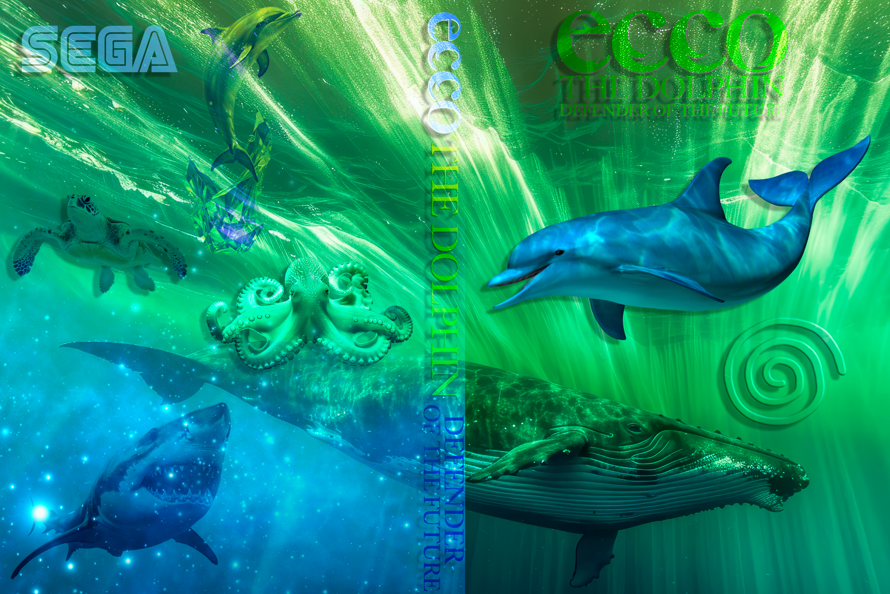
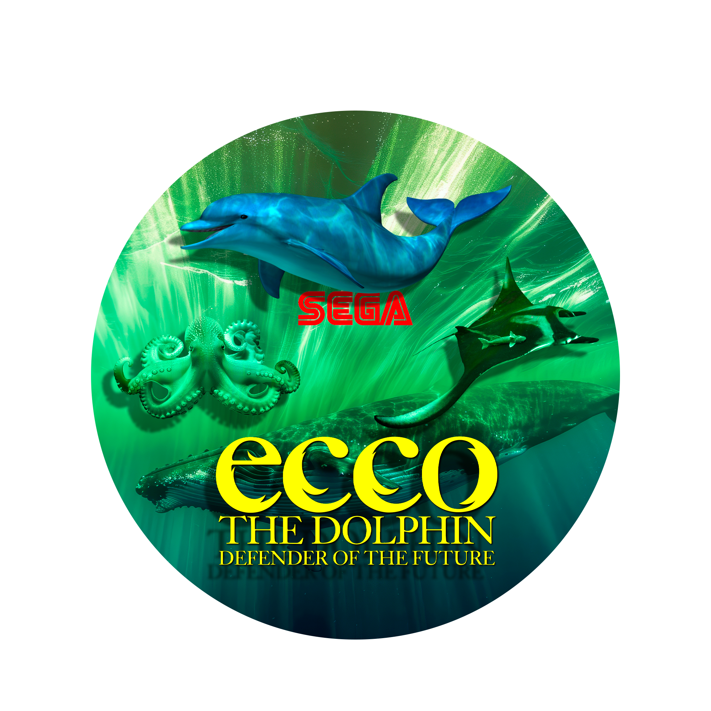

# Ecco the Dolphin: Defender of the Future: Recompiled (Dreamcast)
<p align="center">
  &nbsp;&nbsp;
  
</p>

<p align="center">
  <a href="https://github.com"></a>
  <a href="https://github.com"></a>
  <a href="https://github.com"></a>
</p>

A native PC port of **Ecco the Dolphin: Defender of the Future** (Dreamcast, Europe, Appaloosa
Interactive / Sega 2000), built with [dreamcomp](https://github.com/cherryduck/dreamcomp/tree/linux-ecco).
The game's SH-4 code is statically recompiled to C++ ahead of time, and the Dreamcast's graphics,
sound and disc hardware run as native code around it. It is not an emulator running the
original binary.

**You need your own copy of the game.** This repository contains no game code or data. The port
reads your disc image at run time and refuses any release other than the one it was built from:
Europe, MK-5103350 V1.003, boot file `0.BIN`, SHA-1 `e6b20996...e921d264c0`.

## Status

The whole game can be played through on Linux: intro, menus, all levels, music and effects, and
memory-card saves. Checked by playing it end to end and with scripted runs that compare the
recompiled code against the engine's SH-4 interpreter.

| | |
|---|---|
| Platform | Linux x64 (CachyOS, g++ 16, Vulkan, Wayland) and **Windows x64** (Windows 10/11, clang-cl / MSVC, Vulkan / DXGI). macOS untested |
| Disc | Europe only (MK-5103350). The USA and Japanese releases are different binaries |
| Recompiled code | 17,574 functions, 0 untranslated calls over menus and gameplay |

## Features

- **Widescreen without stretching** (Aspect ratio: Expanded, up to 21:9). The field of view gets
  wider and the vertical view stays the same. This is done through the game's own projection
  function, not Flycast's cheat, which changes `tan()` everywhere in the game. The health and air
  bars keep their 4:3 shape. The menu cursor is fixed up for wide shapes
- **Internal resolution** up to 8x (`scale`)
- **High refresh rate**: frames blended between game frames on displays above 60 Hz (`fps`). The
  game logic stays at its own rate
- **Accurate translucency**: see-through surfaces are sorted per triangle, so above-water rock no
  longer shows through the sea surface from below
- Saves to a per-user virtual memory card; rumble; keyboard and gamepad, rebindable in game
- Texture dumping and replacement packs, file mods (dreamcomp `docs/TEXTURE-PACKS.md`, `docs/MODS.md`)

## Windows & Linux Installers + Dual-Version DC PC Launcher (Recommended)

Download the graphical installer for your platform to set up this native Dreamcast-to-PC static recompilation port with the interactive **DC PC Graphical Launcher** and two isolated game editions:

- **Windows Installer:** **[Ecco_the_Dolphin_Online_Setup_v13.exe](https://github.com/DolphinPS2/ecco-the-dolphin-defender-of-the-future-recomp/releases/download/v1.3/Ecco_the_Dolphin_Online_Setup_v13.exe)** (with desktop, Start Menu, and taskbar shortcuts).
- **Linux / Steam Deck Installer:** **[Ecco_the_Dolphin_Linux_Setup.run](https://github.com/DolphinPS2/ecco-the-dolphin-defender-of-the-future-recomp/releases/download/v1.3/Ecco_the_Dolphin_Linux_Setup.run)** (fast prebuilt engine setup with `.desktop` application shortcuts).
- **Europe Original (`MK-5103350`, En / Fr / De / Es)** - authentic European Dreamcast release with widescreen (up to 21:9), up to 8x internal resolution, and high refresh rate interpolation.
- **Paradox Russian Edition (`Paradox RUS` - Full Russian Text & Voiceover)** - automatically extracted from your Paradox `.cdi` / `.chd` / `.gdi` disc image during setup, with isolated settings and virtual memory card (`VMU`) saves.

### Установка на Windows и Linux (на русском языке)

- **Windows:** Скачайте и запустите **[Ecco_the_Dolphin_Online_Setup_v13.exe](https://github.com/DolphinPS2/ecco-the-dolphin-defender-of-the-future-recomp/releases/download/v1.3/Ecco_the_Dolphin_Online_Setup_v13.exe)**, выберите папку установки, ярлыки (Рабочий стол, меню «Пуск», Панель задач) и укажите ваши образы дисков (**Europe** `.chd`/`.cue`/`.gdi` и опционально **Paradox RUS** `.cdi`/`.chd`/`.gdi`).
- **Linux / Steam Deck:** Скачайте **[Ecco_the_Dolphin_Linux_Setup.run](https://github.com/DolphinPS2/ecco-the-dolphin-defender-of-the-future-recomp/releases/download/v1.3/Ecco_the_Dolphin_Linux_Setup.run)** в папку «Загрузки», откройте там терминал и выполните:
```bash
chmod +x Ecco_the_Dolphin_Linux_Setup.run
./Ecco_the_Dolphin_Linux_Setup.run
```
Откроется графический мастер установки с иконкой дельфина, выбором папки, выбором обоих образов дисков и созданием ярлыков `.desktop` в меню приложений.

## One-Click Automated Build (Windows & Linux)

1. Place your **Europe** disc image (.chd / .cue / .gdi) and optionally your **Paradox Russian** disc image (.cdi / .chd / .gdi) on disk.
2. Run **windows\build_windows.bat** or **linux/build_linux.sh** to build the game, download the [DC PC Graphical Launcher](https://github.com/DolphinPS2/ecco-the-dolphin-defender-of-the-future-recomp/releases/tag/v1.1), and extract Russian mod files automatically.

## Building (Windows)

Tested and verified on Windows 10/11 x64. See **[docs/WINDOWS-BUILD.md](docs/WINDOWS-BUILD.md)** for full prerequisites, step-by-step PowerShell commands, standalone launcher/installer sources (`windows/`), and solutions to known Windows build traps:

- **CMake font download hang:** `DreamcompFrontend.cmake` can stall indefinitely while downloading `Inter` / `PromptFont` fonts during CMake configuration (pre-cache the fonts or pass `-DDREAMCOMP_FRONTEND=OFF` when using `windows/launcher.py`).
- **Required `linux-ecco` branch:** Always build against `cherryduck/dreamcomp` branch `linux-ecco` (`DREAM_GEN_SHARDS`); building without code sharding emits all 17,574 functions into one file and hangs the compiler.
- **Environment:** Initialize `vcvars64.bat` (needed for `ml64.exe` when building `chdr.dll`) and set `$env:PYTHONUTF8 = "1"` on non-UTF-8 Windows locales.

## Building (Linux)

Needs cmake, ninja, a C++20 compiler, Python 3, SDL3, the Vulkan headers and `glslc`. On Arch or
CachyOS:

```sh
sudo pacman -S --needed cmake ninja sdl3 vulkan-headers vulkan-icd-loader shaderc python
```

The port builds inside a dreamcomp checkout. The Linux fixes and the engine changes this port needs
are on the `linux-ecco` branch of the fork:

```sh
git clone -b linux-ecco --recurse-submodules https://github.com/cherryduck/dreamcomp
cd dreamcomp
python3 -m venv .venv && .venv/bin/pip install -e "engine/tools/dcdisc[test]" pillow
git clone https://github.com/cherryduck/ecco-the-dolphin-defender-of-the-future-recomp \
    ports/ecco-the-dolphin-defender-of-the-future-recomp

P=ports/ecco-the-dolphin-defender-of-the-future-recomp
.venv/bin/python tools/dc.py setup $P --disc "/path/to/Ecco the Dolphin - Defender of the Future (Europe) (En,Fr,De,Es).cue"
.venv/bin/python tools/dc.py build $P
.venv/bin/python tools/dc.py run   $P --window
```

`setup` checks the disc and extracts only the boot executable, which the recompiler needs at build
time. Everything else is read from the image while you play. Accepted formats are Redump
`.cue`/`.bin`, `.gdi` and `.chd`. The generated code is split into one part per CPU thread
(`DREAM_GEN_SHARDS`), so a fresh build takes about a minute on a 32-thread machine.

The executable ends up at `$P/build/game/ecco-the-dolphin-defender-of-the-future-recomp`. Started
with no arguments, it opens with your saved settings.

## Playing

| | |
|---|---|
| Keyboard | arrows = d-pad, Z X A S = A B X Y, Enter = Start, Q W = triggers |
| Menu | Escape or the pad's Select: settings, controls, quit |
| Keys | F1 HUD editor, F2 HUD list, F10 FPS counter, F11 frame capture, F12 screenshot |
| Settings | `~/.config/dreamcomp/ecco/settings.ini` (edited by the in-game menu) |
| Memory card | `~/.config/dreamcomp/ecco/vmu_a1.bin` |

When you start the game, *Select a Game* lists your existing saves under *New Game*. The game
refuses to create a second save with initials it already has, so pick the existing one.

## Known limitations

- Widescreen is limited to 21:9; wider shapes have not been checked
- About 1 % of the screen can still have see-through layers in the wrong order where triangles
  really pass through each other; the console sorts per pixel
- In fast turns at high refresh rates, some in-between frames are skipped instead of tearing, so
  the motion there briefly drops back to the game's own rate
- The frame-wait idle skip used by other dreamcomp ports does not apply to this game's library
  (Kamui2), so the game thread busy-waits for vblank

Environment switches for A/B comparisons: `DREAM_STRIP_SORT=1` (old per-strip translucency sort),
`DREAMCOMP_NO_HUD_FIX=1` (stretched HUD).

## How it was made

`docs/GAME-INTERNALS.md` records what was measured about the game and how: the CodeWarrior link
address, the Katana stub relocations, the projection builder, the HUD layers and the menu cursor.
`docs/PLAN.md` has the phases, decisions and verified checkpoints, and `docs/findings/phase-00.md`
the disc survey. The engine changes are listed in dreamcomp's `docs/engine-changes.md`, and the
traps found along the way are entries T26-T31 in its playbook.

## Credits

- Ecco the Dolphin: Defender of the Future (c) 2000 Sega, developed by Appaloosa Interactive. This
  project is not affiliated with Sega or Appaloosa.
- [dreamcomp](https://github.com/danielgomesvieira2000/dreamcomp) (danielgomesvieira2000), built
  on [dream-recomp](https://github.com/phobos665/dream-recomp) (phobos665), which draws on
  [Flycast](https://github.com/flyinghead/flycast).
- The widescreen projection was located from Flycast's widescreen cheat table entry for
  MK-5103350.

## AI use

Developed with AI assistance (Claude), following dreamcomp's workflow; see dreamcomp's README.

## Licence

GPL-2.0.


---
### Поисковые теги / Search Keywords
**Русский:** Экко Дельфин: Защитник Будущего на ПК (Windows / Linux / Steam Deck) — нативный порт версии SEGA Dreamcast (не эмулятор). Включает европейскую версию (Europe MK-5103350) и русскую версию с полной озвучкой и переводом Paradox (Paradox RUS), поддержку широкоформатных экранов 16:9 и 21:9, высокое разрешение и 60+ FPS.

**English:** Ecco the Dolphin: Defender of the Future Native PC Port for Windows 10/11, Linux, and Steam Deck (SEGA Dreamcast static recompilation via dreamcomp). Supports Europe Original edition (MK-5103350) and Paradox Russian edition (Paradox RUS) with graphical launcher, widescreen 21:9, and high refresh rate.
